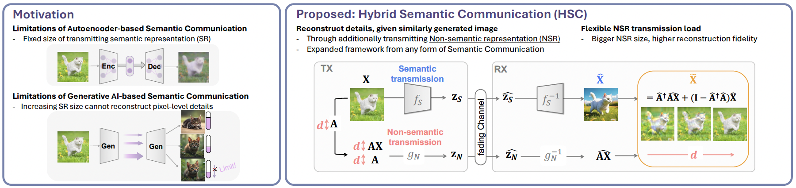
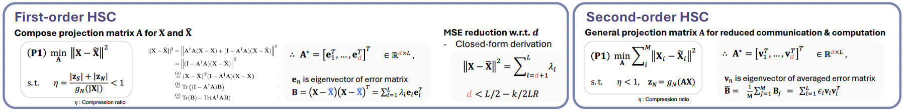
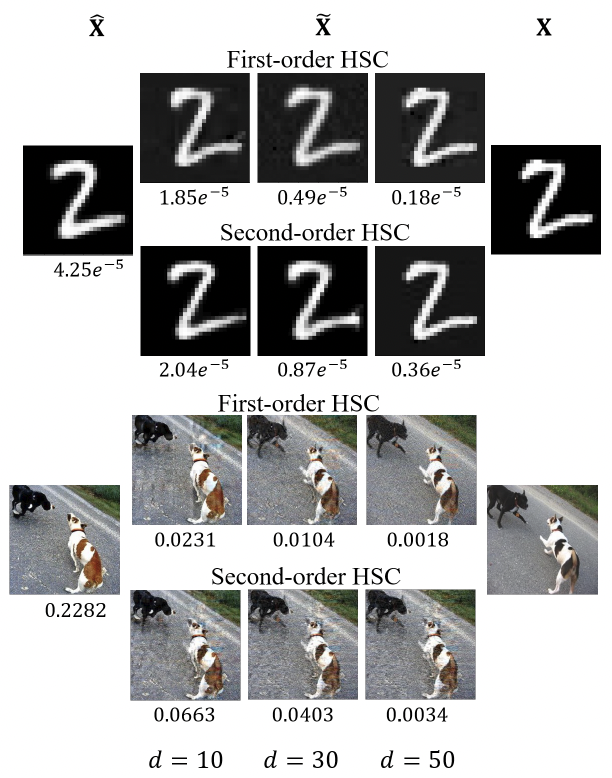

# Residual Non-Semantic Extraction

**Hybrid Semantic Communication for Controllable Image Reconstruction Fidelity**

This repository provides the implementation of **hybrid semantic communication (HSC)**, which complements AI-based semantic representations with residual image-specific information for high-fidelity wireless image reconstruction.

By adjusting the size of the transmitted **non-semantic representation (NSR)** with linear projection encoding process, HSC controls reconstruction fidelity given as a mathematical closed form beyond the limitations of a fixed semantic representation.

[](#)
[](#)
[](#)
[](#)

---

## Publication

**Hybrid Semantic Communication for Controllable Fidelity in Wireless Image Transmission**

**H. Nam**, J. Park, J. Choi, M. Bennis, and S.-L. Kim

*Submitted to IEEE Transactions on Cognitive Communications and Networking (under revision).*

---

**Hybrid Semantic-Complementary Transmission for High-Fidelity Image Reconstruction**

**H. Nam**, J. Park, J. Choi, and S.-L. Kim

*IEEE International Conference on Acoustics, Speech and Signal Processing (ICASSP), Barcelona, Spain, 2026, pp. 21326–21330.*

[](https://doi.org/10.1109/ICASSP55912.2026.11464070)
[](https://scholar.google.com/citations?view_op=view_citation&hl=ko&user=KTjNYtAAAAAJ&sortby=pubdate&citation_for_view=KTjNYtAAAAAJ:eQOLeE2rZwMC)

---

## Overview


<p align="center">
  
</p>


Semantic communication can preserve the overall meaning of an image while losing image-specific details. Autoencoder-based systems typically use a fixed-size semantic representation, while increasing the semantic payload in GenAI-generated representation does not necessarily recover pixel-level details.

HSC supplements semantic transmission with a compact projection of the source image, **AX**, that conveys information missing from the semantic reconstruction. At the receiver, this NSR refines the reconstructed image. The projection dimension **d** determines the additional transmission load and enables controllable reconstruction fidelity across autoencoder- and generative AI-based frameworks. The linear projection method is proposed in two ways.


<p align="center">
  
</p>

### First-Order HSC

An image-specific projection matrix **A** is constructed from the dominant eigenvectors of the reconstruction-error matrix. It targets the residual details of each image, with a closed-form characterization of reconstruction MSE as the projection dimension increases.

### Second-Order HSC

A shared projection matrix is precomputed from the averaged reconstruction-error matrices of a reference image set. Reusing this matrix reduces per-image computation and the communication overhead of conveying image-specific projection matrices.

---

## Results
<p align="center">
  
</p>

Increasing the NSR dimension progressively reduces reconstruction MSE and restores image-specific details. The evaluated autoencoder- and GenAI-based systems show greater fidelity improvements from additional NSR transmission than from increasing the semantic representation alone, under noisy channels.
---

## Getting Started

Clone the repository and configure the dataset and checkpoint paths for your environment. Prepare the trained semantic model and, for second-order HSC, the corresponding projection matrices in `As/<method>/`. Ensure that the `results/` directory exists.

```bash
git clone https://github.com/NamHyelin/Residual-Non-Semantic-Extraction.git
cd Residual-Non-Semantic-Extraction
mkdir -p results
```

### Configuration

Edit the configuration in `test.py` before running an experiment. These are Python variables, not command-line arguments.

| Setting | Configuration |
| --- | --- |
| `model` / `model_method` | Select the semantic model and its matching checkpoint. The current `test.py` instantiates `VAE(x_dim, hidden_dim)`; `model_method = "VAE"` selects `VAE.pth` from the configured checkpoint directory. |
| `method` | Select the projection-matrix directory, such as `method = "VAE"` for `As/VAE/`. This is used when loading precomputed matrices for second-order HSC. |
| Output name (`save_method`) | The output label, referred to as `save_name`, is named `save_method` in the current code. Use `"VAE_FirstOrder"` for image-specific projection or `"VAE_SecondOrder"` for precomputed projection. The substring `SecondOrder` also selects the second-order branch; it is not only a filename label. |

For example, use the following settings for second-order HSC with a VAE:

```python
model_method = "VAE"
method = "VAE"
save_method = "VAE_SecondOrder"
```

For first-order HSC, change `save_method` to `"VAE"`. Keep the model architecture, checkpoint, and precomputed matrices consistent with the selected experiment.

### Run Evaluation

```bash
python test.py
```

The default entry point evaluates reconstruction error as the NSR dimension varies. For SNR evaluation in the current repository, replace the final `test(...)` call with the existing `test_SNR_2(...)` call:

```python
test_SNR_2(bidx=bidx, method=method, save_method=save_method)
```


Evaluation outputs are saved under `results/` using the selected `save_method` label.

---

## Citation

```bibtex
@inproceedings{nam2026hybrid,
  title={Hybrid Semantic-Complementary Transmission for
         High-Fidelity Image Reconstruction},
  author={Nam, Hyelin and Park, Jihong and Choi, Jinho
          and Kim, Seong-Lyun},
  booktitle={2026 IEEE International Conference on Acoustics,
             Speech and Signal Processing (ICASSP)},
  address={Barcelona, Spain},
  pages={21326--21330},
  year={2026},
  organization={IEEE},
  doi={10.1109/ICASSP55912.2026.11464070}
}
```

---

<p align="center">
  <sub>Developed for research on controllable-fidelity semantic communication and wireless image transmission.</sub>
</p>
